# Exploratory data analysis: report

Agentic Swing-Trade Intelligence for NSE stocks. EDA notebooks 01–04, written for the project team and the capstone reviewers.

**How to read the numbers.** Each number cites the notebook and section it comes from: (E02 §2) means `notebooks/eda/02_prices_returns.ipynb`, section 2. The notebooks are:

- [01_data_inventory](../../notebooks/eda/01_data_inventory.ipynb)
- [02_prices_returns](../../notebooks/eda/02_prices_returns.ipynb)
- [03_events](../../notebooks/eda/03_events.ipynb)
- [04_macro_flows](../../notebooks/eda/04_macro_flows.ipynb)

Each one runs top to bottom on a fresh kernel and ends with a "Findings" cell.

**Periods.** Train is 2016–2022, validation is 2023, and test is 2024 onwards. Return and signal analysis uses 2016–2023 only. Coverage and quality checks use the full range, which ends in Nov 2026. No test-period returns were analysed.

**Universe.** The current 50 Nifty 50 stocks plus the Nifty 50 index and India VIX.

**Returns** are daily log returns, quoted in % of price, unless stated otherwise.

**Price basis.** The EDA ran on raw prices, dropping each stock's return on every corporate-action ex-date. Adjusted prices (task 2.4, `src/store/adjust.py`) reached `main` after the notebooks were run. E02 and E03 should be re-run on them once `data/derived/prices_adj` is built and the 15 manual factors are hand-checked (open item 13).

---

## 1. Summary

1. **The price data is complete, with three exceptions to fix.** No trading day is missing from 2016 to Nov 2026 (0 of 2,681), and there are no duplicates or zero-volume rows (E01 §2a). The exceptions:
   - The Sunday 1 Feb 2026 Budget session is missing everywhere (E01 §5h).
   - The calendar marks 6 weekday Muhurat sessions as closed (E01 §5a).
   - TATACONSUM and SHRIRAMFIN lack their history before their 2020 and 2022 symbol changes (E01 §5b).
2. **The accuracy bar for direction models is the constant guess, and it moves.** On the label that matches the trade (open of day d to close of d+h−1), the share of up moves in train is 45.8% / 51.5% / 53.6% at 1 / 5 / 10 days. In 2023 it is 46.8% / 56.4% / 61.1%. Always guessing the majority class scores 53.2% / 56.4% / 61.1% in 2023 (E02 §2).
3. **Returns are almost unpredictable from past returns; volatility is predictable.**
   - The median lag-1 autocorrelation of daily returns is −0.012 (E02 §3).
   - For absolute returns it is 0.175, still above 0.05 at lag 20.
   - India VIX correlates 0.58 with the Nifty's next-5-day volatility (E04 §3).
4. **Company events change how much prices move, not which way.**
   - Results and board-meeting outcomes roughly double the day-0 move (1.5–2.0× random days).
   - Only 2 of 45 directional tests clear the random-day control, about what chance gives (E03 §3, §5).
5. **Overnight US moves are already in the opening price.** They explain 16.5% of the Nifty's opening gap and 0.3% of the move after the open. None of them predicts a 5-day return from the open (E04 §2).
6. **2023 is a calm, rising year, so it can't test a model under stress.** India VIX was in its low band on 89% of days and never in its high band (train: 33% / 34%). The Nifty's daily std was 0.6%, against 1.1% in train (E02 §10).
7. **The results timestamp in `financial_results` is often late.** For about 55% of 2016–2023 results, the "Financial Result Updates" announcement and the price reaction come one or more trading days before it (E03 §4).

---

## 2. Data available

One row per lake table, from the inventory (E01 §1). "Period" uses each table's main date column.

| Dataset | Rows | Stocks | Period | Source | Status |
|---|---:|---:|---|---|---|
| prices_daily | 125,999 | 50 | 1 Jan 2016 – 6 Nov 2026 | NSE bhavcopy | Complete; raw, unadjusted prices |
| index_daily | 5,374 | 2 series | 1 Jan 2016 – 6 Nov 2026 | NSE index file (1 day from yfinance) | Complete (Nifty 50, India VIX) |
| corporate_actions | 854 | 49 | ex-dates 21 Jan 2016 – 6 Nov 2026 | NSE API | Complete; 15 rights/demergers need manual factors; no announcement time |
| financial_results | 5,625 | 48 | quarters 2005 – Dec 2024 | NSE API | Filing list only (no figures); stops at the Dec 2024 quarter |
| board_meetings | 944 | 50 | meetings 26 Apr 2024 – 13 Nov 2026 | NSE API | Latest ~20 per stock only |
| announcements | 74,876 | 50 | 1 Jan 2016 – 7 Nov 2026 | NSE API | Complete except NESTLEIND 2016–2022 |
| announcement_text | 14 | 5 | Jun 2024 | NSE PDFs | Pilot only |
| insider_trades | 100,848 | 46 | 2015 – Apr 2026 | NSE API | Thins sharply after 2021 |
| shareholding | 1,081 | 50 | quarters 2021 – Sep 2026 (3 earlier rows) | NSE API | History starts in 2021 |
| pledges | 5 | 5 | Oct 2026 | NSE API | Pilot only; endpoint returned nothing in the full run |
| fii_dii | 2 | – | 29 Oct 2026 | NSE API | Daily job only; no history |
| macro | 14,140 | 5 series | 1 Jan 2016 – 5 Nov 2026 | FRED | Complete; usable next day |
| news | 14 | 6 | 28 Jun 2024 | GDELT | Pilot only |

Prices have a value on 100% of trading days for every stock-year, counted from each stock's first day. Stocks listed after 2016 (BSE, SBILIFE, HDFCLIFE, MAXHEALTH, ETERNAL, JIOFIN) start at their listing (E01 §2a).

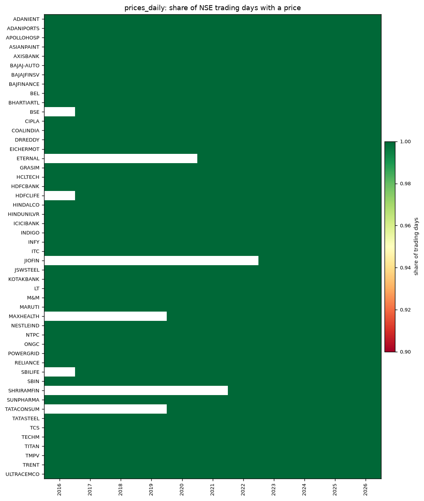

The event tables are much less even than prices. Insider rows fall from 19,236 in 2016 to 2,127 in 2023. Shareholding covers 48–50 stocks only from 2021 (E03 §6).

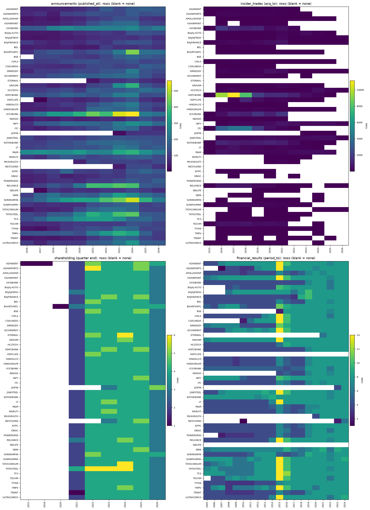

---

## 3. Data quality

E01 reconciled 33 gaps and oddities against the known open items and found 14 new ones (E01 §5g). E03 and E04 added one each. All are listed in "Open items" in [docs/DATA_COLLECTION.md](../../docs/DATA_COLLECTION.md) (items 8, 13 and 15–26).

### Fixes applied during the EDA
- **DuckDB views.** `data/market.duckdb` stored absolute paths from another machine, so all 13 views failed until rebuilt with `python -m src.ingest views` (E01 §5g; open item 24).
- **Event-day helper.** `first_informed_day` assigned records published before the calendar's first day to that day. Results from 2005–2015 were landing on 1 Jan 2016. They now get no day (fixed in E03, with a test). One E01 number changed: results that inform the next trading day went from 99.6% to 99.4% (E01 §4).

### Open gaps, by effect on training (2016–2023) first

| Gap | Evidence | Effect on the project | Fix (open item) |
|---|---|---|---|
| EDA ran on raw prices | 604 ex-date returns dropped, 0.67% of stock-days (E02 setup) | Every return analysis drops ex-dates. 262 of 1,425 results windows (18%) are lost, biased toward quarters with no dividend in the window (E03 §3) | Task 2.4 code is now on `main`: build `prices_adj`, hand-check the 15 factors (13), re-run E02 and E03 |
| TATACONSUM and SHRIRAMFIN history before renames | Prices start 27 Feb 2020 and 20 Dec 2022 (E01 §5b) | About 4 and 7 years of training data missing; SHRIRAMFIN is left out of train-only statistics (E02 §3) | Map TATAGLOBAL and SRTRANSFIN (16) |
| Results timestamp often late | "Financial Result Updates" a median 21 h earlier; reaction on our day −1 (2.79% vs 1.63%) when it is 1 day earlier (E03 §4) | Results event dates are late for about 55% of results: safe for the time rule, but results features and event memory lose most of the reaction | Use the announcement time (26) |
| Weekday Muhurat sessions marked closed | 6 days with prices, 2017–2025 (E01 §5a) | Trading-day counts (horizons, event days) are off by one around Diwali if the calendar is used | Add to calendar overrides (17) |
| Event data missing for whole stocks | NESTLEIND 0 announcements 2016–2022; no insider rows for BSE, ETERNAL, NESTLEIND, POWERGRID; no results for HDFCLIFE, SBILIFE (E01 §5e–f) | Event features and event memory are empty for these stocks | Check the endpoints by hand (18) |
| Shareholding from 2021 only | 1 stock or fewer a year before 2021, 48 in 2021 (E01 §5f) | No shareholding features in most of train | Find older quarters or use 2021+ only (19) |
| Insider data thins after 2021 | 19,236 rows (2016) → 2,127 (2023) → 1,490 (2025), by disclosure year (E03 §6) | Not usable as a feature in validation or test | Open items 9 and 12 |
| Corporate actions have no announcement time | `published_at` 100% null (E01 §4) | The catalyst calendar can't place them in time | Use announcements (20) |
| Nifty change columns wrong on 13 Mar 2023 | points_change −435.30 measured from 9 Mar (E01 §5h) | A validation-year return is wrong if `change_pct` is used | Always use closes (21) |
| 3 ADANIENT moves > 20% with no corporate action | 26 Apr 2017, 20 May 2019, 25 Aug 2020 (E01 §5c) | Must be confirmed before task 2.4's jump check | (22) |
| Missing session, Sun 1 Feb 2026 | 41 of 50 stocks' NSE prev_close disagrees with our close; the Nifty's implied previous close is 24,825.45 vs our 25,320.65 (E01 §5h) | Test period: a missing day for every stock, and a wrong 1-day return on 2 Feb 2026 | Add the day and download it (15) |
| Results list ends at the Dec 2024 quarter | 48 open `results_list_stale` reviews (E01 §3) | No results in most of the test period | Open item 1 |
| RBI, FII/DII, news not collected | 0, 2 and 14 rows (E04 §4–6) | Those inputs can't be evaluated | Tasks 4.3, 4.1–4.2, 5.1–5.2 |
| News matching is noisy | 1 of 14 pilot headlines names the matched company (E04 §6) | Without better matching, most "company news" would be unrelated | Fix aliases before the full run (8) |
| Tracker coverage table out of date | Built for June 2024 only, 1,045 rows (E01 §3) | The backtest's gap list would be incomplete | Re-run `python -m src.ingest coverage` (23) |

Two quality checks passed:
- **Timestamps are good enough for the time rule.** 99.99% of announcements and 100% of results broadcast times carry a real time of day (E01 §4).
- **Every FRED value becomes usable exactly one day after its date** (E04 §1).

---

## 4. Price behaviour (E02)

Prices are raw closes, with each stock's returns dropped on every corporate-action ex-date until adjusted prices exist. That drops 604 returns, 0.67% of stock-days.

### Returns have fat tails
- **Stocks.** Pooled daily stock returns have a std of 2.01%, skew of −0.20 and excess kurtosis of 11.6. 1.55% of days lie beyond 3 standard deviations, against 0.27% for a normal distribution (E02 §1).
- **Nifty.** Std 1.07%, skew −1.47, kurtosis 22.5.
- **Longer horizons.** The tails stay heavy at 5 and 10 days (kurtosis 7.0 and 5.4).

### Base rates
Share of up moves, stocks pooled (E02 §2):

| Label | Horizon | Train 2016–22 | Validation 2023 |
|---|---|---:|---:|
| close(d−1) → close(d+h−1) | 1 day | 50.7% | 53.2% |
| | 5 days | 53.4% | 59.0% |
| | 10 days | 55.0% | 62.4% |
| open(d) → close(d+h−1) | 1 day | 45.8% | 46.8% |
| | 5 days | 51.5% | 56.4% |
| | 10 days | 53.6% | 61.1% |

**Stocks fall during the session.** The open-to-close label is up only 45.8% of the time at 1 day, so the positive drift happens overnight. Base rates also move a lot:
- **By year:** the 10-day close label is up 48.8% of the time in 2018 and 59.7% in 2017.
- **By stock:** it ranges from 40.2% to 62.4% across stocks in train.

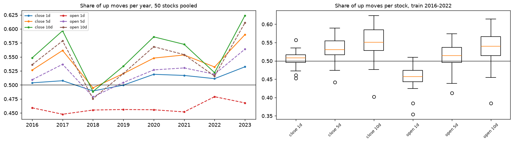

### Predictability
Train period (E02 §3–4).

**Returns** carry almost no linear information:
- The median lag-1 autocorrelation is −0.012, and only 9 of 48 stocks fall outside ±0.047.
- The Nifty's apparent lag-5/6 autocorrelation (+0.115 / −0.121) comes entirely from 2020. Without 2020 the largest value is 0.058.
- The ADF test finds a unit root in log prices (rejected for only 1 of 49 series) and stationarity in returns (rejected for 49 of 49).

**Absolute returns** cluster strongly. Their lag-1 autocorrelation is 0.175 for the median stock and 0.283 for the Nifty, significant for all 48 stocks.

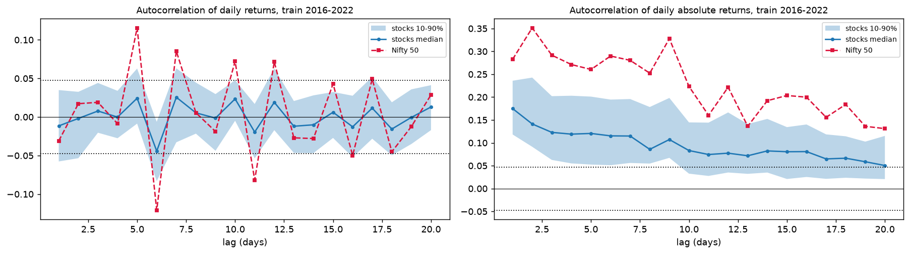

### Opening gaps
Train period (E02 §5).
- **Size.** The median absolute gap is 0.39% of price, against 0.99% for the intraday move. Gaps carry 20% of daily variance for the median stock and 37% for the Nifty.
- **Stops.** With a median 14-day ATR of 2.67% of price, the open gaps past a 0.5 / 1 / 2 ATR stop on 6.8% / 1.26% / 0.18% of stock-days.

### Volatility and the historical-volatility baseline (task 16.5)
The baseline forecasts the next 5 or 10 days' volatility with the last 20 days' (E02 §6).

| Measure | Train 5 d | Train 10 d | 2023 5 d | 2023 10 d |
|---|---:|---:|---:|---:|
| Correlation with outcome | 0.43 | 0.48 | 0.43 | 0.49 |
| MAE, historical volatility | 0.772% | 0.657% | 0.601% | 0.514% |
| MAE, constant per-stock volatility | 0.731% | 0.614% | 0.794% | 0.735% |

The baseline loses to a constant in train, because the 2020 shock makes trailing windows lag. It wins in 2023. Annualised volatility of the median stock ranges from 22.5% (2017) to 38.8% (2020), and is 19.5% in 2023.

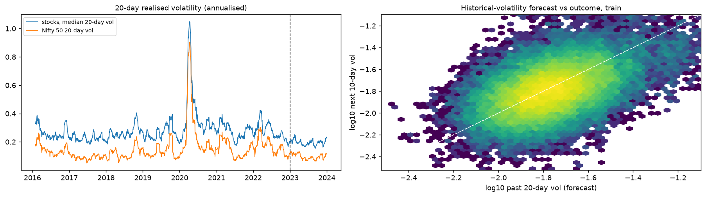

### Market link and sectors
Train period (E02 §7).
- **Beta to the Nifty:** median 0.95, from 0.47 (CIPLA) to 1.51 (TMPV). The median correlation is 0.52.
- **Within vs across sectors:** pairwise correlation is 0.42 within a sector and 0.28 across.
- **Sector betas:** Healthcare 0.59, FMCG 0.70 and IT 0.75 are the defensive end; Metals 1.36 and Financials 1.14 are the high end.

### Regimes
From `src/features/regime.py`. Every label is lagged one day (E02 §8).
- **Settings.** India VIX bands are train terciles, with cut-points 14.79 and 18.35. The trend label compares the Nifty with its 200-day EMA.
- **Volatility by regime.** The Nifty's daily std is 0.85% above the EMA and 1.97% below it. By VIX band it is 0.63% / 0.90% / 1.60% (low / mid / high).
- **Rebounds after stress.** Stocks' 5-day up share is 56.5% below the EMA vs 52.5% above, and 55.9% at high VIX vs 50.8% at low.

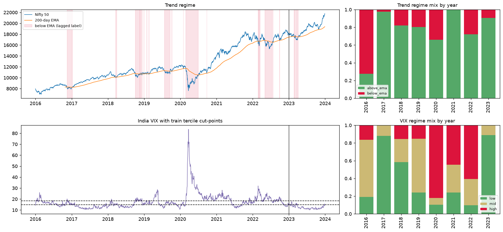

### Liquidity
All 50 stocks are liquid (E02 §9).
- The median stock trades ₹194 crore a day. The lowest are TRENT (₹16 crore) and BSE (₹17 crore).
- There are no zero-volume days.
- The median stock's turnover rose from ₹99 crore (2016) to ₹259 crore (2023).

---

## 5. Events (E03)

**Method:**
- **Abnormal return** = stock return − Nifty return.
- **Day 0** is the first trading day whose 08:30 IST forecast may use the record.
- **Intervals** are 95% bootstrap intervals that resample whole calendar weeks.
- **Control:** each event set has its own random-day control, with the same number of days per stock.

### When events can be used
- 2016–2023 has 50,076 announcements, 26.2% of them tagged important (E03 §1).
- Only 1.5% arrive before 08:30 IST, early enough to inform the same day. 69.8% inform the next calendar day, and 28.6% wait 2 or more calendar days (weekends, holidays) (E03 §2).
- Results come 63.5% after 15:30, 35.5% during market hours and 1.1% before 08:30 (E03 §4).

### Size, not direction
CAR = cumulative abnormal return from day 0 (E03 §3).

| Event set | Events | CAR[0,+5] | Share CAR[0,+5] > 0 | \|CAR[0,+1]\| | Random-day control \|CAR[0,+1]\| |
|---|---:|---:|---:|---:|---:|
| Results (financial_results) | 1,125 | +0.27% [−0.03%, +0.58%] | 51.4% | 2.36% * | 1.67% |
| Financial Result Updates | 1,125 | +0.26% [−0.10%, +0.61%] | 49.9% | 3.27% * | 1.71% |
| Outcome of Board Meeting | 872 | +0.39% [+0.03%, +0.74%] | 50.5% | 2.94% * | 1.67% |
| All important announcements | 9,977 | +0.12% [−0.01%, +0.26%] | 49.6% | 2.11% * | 1.70% |
| Press Release | 4,668 | +0.09% [−0.08%, +0.26%] | 49.7% | 1.81% * | 1.66% |
| Acquisition | 514 | +0.30% [−0.16%, +0.77%] | 49.6% | 1.87% | 1.88% |
| SEBI takeover disclosures | 367 | +0.59% [−0.01%, +1.16%] | 55.0% | 1.96% | 1.72% |
| Credit Rating | 292 | +0.05% [−0.65%, +0.66%] | 51.0% | 1.98% * | 1.68% |
| Change in Director(s) | 314 | −0.11% [−0.58%, +0.35%] | 43.6% | 1.89% * | 1.51% |

\* means the interval for (event − control) excludes 0. The full table, with 15 sets and all horizons, is in E03 §3.

- **Size.** The absolute move after results and board-meeting outcomes is 1.4–1.9× that on random days.
- **Direction.** No event set's signed CAR at +1, +5 or +10 days clears its control, except two small negative ones: Updates at +5 days (−0.24%) and Appointment at +10 days (−0.42%). That's 2 of 45 tests, about what chance gives.

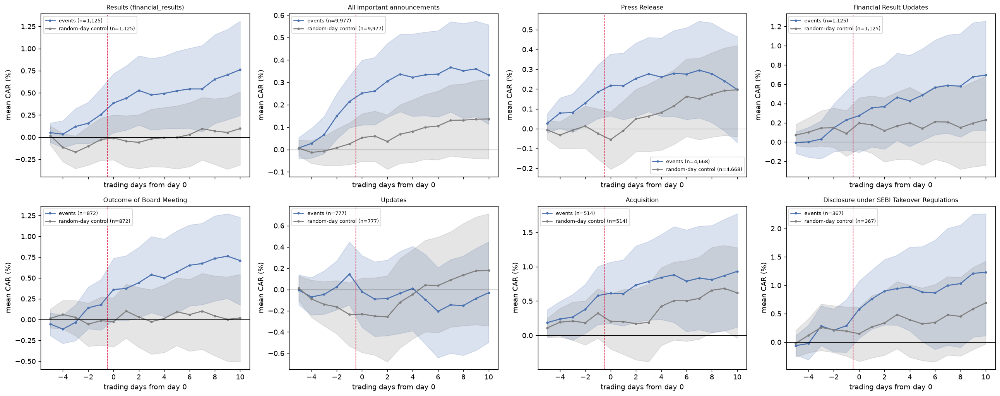

**Before the announcement.** Prices drift up in the 5 days before important announcements: +0.21% [+0.10%, +0.33%], beyond the control.

**On day 0, most of the extra move comes after the open.** For results, the mean absolute abnormal gap is 0.76% (control 0.41%) and the intraday move 1.65% (control 1.13%). A 09:15 entry sees most of the event-day move, but its direction can't be told from the event type.

**Event-day volatility.** Mean absolute daily return on day 0 vs random days (E03 §5):
- Financial Result Updates 1.97×, Outcome of Board Meeting 1.95×, results 1.52×, Change in Director(s) 1.26×, all important announcements 1.25×, Press Release 1.13×.
- Acquisitions (1.06×), credit ratings (1.18×) and takeover disclosures (1.09×) can't be told apart from random days.

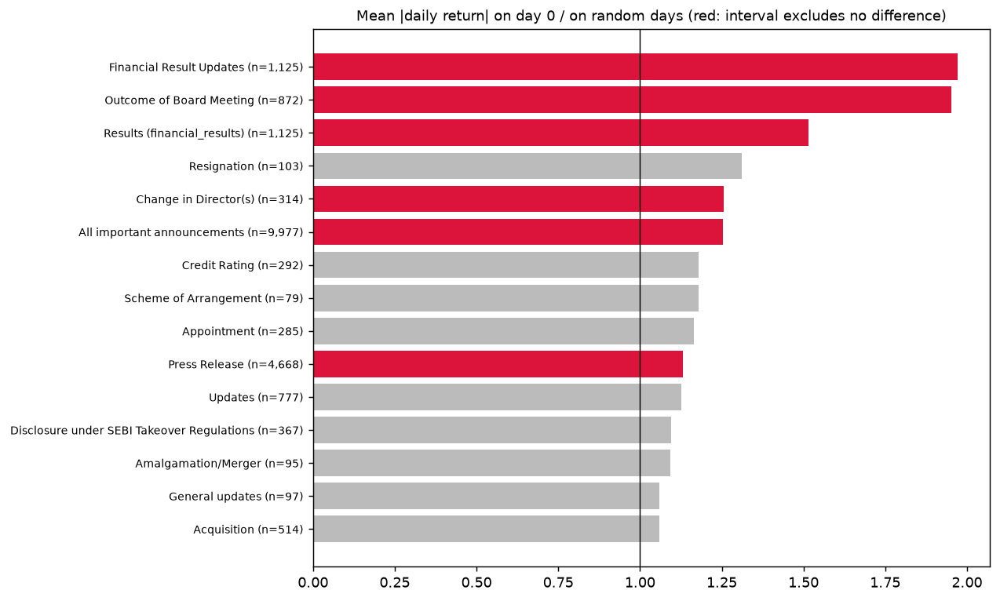

### The results timestamp
- Results released during market hours already move on day −1: mean absolute abnormal return 1.92%, against 1.19% on random days. Day −1 is the publication day, which the time rule can't use.
- The "Financial Result Updates" announcement comes a median 21 hours before `financial_results.broadcast_at`:

  | Announcement timing vs our day 0 | Share of results |
  |---|---:|
  | Same day 0 | 45% |
  | One trading day earlier | 26% |
  | 2–10 trading days earlier | 29% |

- Where it's a day earlier, the reaction sits on our day −1 (2.79% vs 1.63% on day 0) (E03 §4).

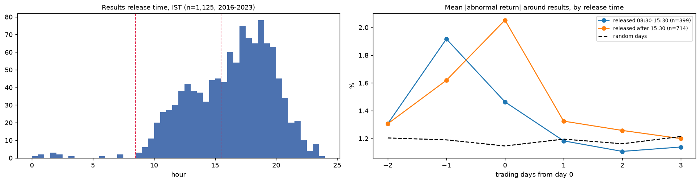

### Promoter trades
2016–2021 (E03 §6):
- **Buys:** 486 events from 20 stocks, 175 of them ADANIPORTS.
- **Sells:** 387 events from 29 stocks, 179 of them AXISBANK.

Neither shows a CAR beyond the control at any horizon. For example, AR on day 0 after sells is −0.14%, with a difference interval of [−0.42%, +0.02%].

---

## 6. Macro, flows and news (E04)

Each macro value is aligned on `known_from`. Day d sees the latest value public by 08:30 IST, which is the previous US close (E04 §1). Intervals use 20-day block bootstraps.

### US markets and the Nifty
Correlation of each overnight US change with the Nifty, train period (E04 §2):

| Series | Opening gap | Intraday move | open(d) → close(d+4) |
|---|---:|---:|---:|
| US VIX | −0.39 [−0.50, −0.30] | +0.04 | −0.03 |
| Broad dollar index | −0.18 | +0.01 | −0.02 |
| USD/INR | −0.15 | −0.01 | +0.02 |
| Brent crude | +0.09 | −0.03 | +0.06 |
| US 10-year yield | +0.01 | +0.01 | −0.04 |

The five series together explain 16.5% of the gap's variance and 0.3% of the intraday move's. In 2023 the US VIX link to the gap is −0.46, and no series predicts the 5-day return from the open.

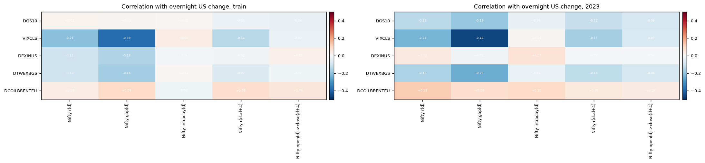

### US VIX vs India VIX
- **Levels** correlate 0.80, and India VIX runs at a median 0.94× US VIX.
- **Volatility forecasting.** India VIX correlates 0.58 with the Nifty's next-5-day volatility (train), and US VIX 0.51. US VIX adds only +0.10 [−0.00, +0.20] beyond India VIX (E04 §3).
- **Bands.** The two VIX indices fall in the same band on 65% of train days but only 33% of 2023 days.

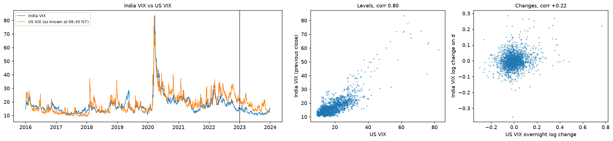

### Blocked items
| Item | Data now | Blocked on |
|---|---|---|
| RBI policy reaction | `rbi_policy.csv` has 0 rows | Task 4.3 (enter about 65 decisions by hand) |
| FII/DII flows | 2 rows, 29 Oct 2026 | Tasks 4.1 (daily job) and 4.2 (NSDL FII history, a DII source) |
| News volume and tone | 14 pilot rows (Jun 2024); 1 of 14 headlines names the company | Tasks 5.1–5.2 (history route and collection), after fixing company matching (open item 8) |

---

## 7. Implications for modelling

### Labels and the bar to beat
- **Use the open(d) → close(d+h−1) label**, which matches entry at the 09:15 open. The close-to-close label credits the model with the overnight gap, which the trade can't capture.
- **Report balanced accuracy, F1 and Brier score** next to plain accuracy. Compare each against the constant majority guess for the same period:

  | Period | 1 day | 5 days | 10 days |
  |---|---:|---:|---:|
  | Train | 54.2% | 51.5% | 53.6% |
  | 2023 | 53.2% | 56.4% | 61.1% |

- **The 1-day label is imbalanced** (45.8% up). Five and ten days are nearer balance in train but lean up in 2023, so a model that always says "up" scores 61% at 10 days in 2023.

### Inputs that look useful
- **Volatility features carry the clearest signal:** realised volatility, ATR, India VIX and the regime labels (absolute-return autocorrelation 0.175; India VIX vs next-5-day volatility 0.58).
- **Beta and sector** explain shared moves (within-sector correlation 0.42 vs 0.28).
- **Rebounds after stress** (higher 5-day up share below the EMA and at high VIX) suggest mean-reversion features such as distance from the EMA or recent drawdown.
- **Event calendars** (results dates from board-meeting notices) should raise the volatility forecast and widen stops. Event direction has to come from the content, such as the results surprise or the announcement text, which the agents can read. The category alone doesn't give it.
- **Overnight US moves** belong in the agents' pre-open context and in setting entry, stop and target levels around the expected gap. They are not return features.
- **Promoter trades and Brent / US 10-year yield** showed no link and are low priority.

### Horizons
- Return predictability is weak at every horizon.
- The 1-day horizon is the most imbalanced and has the largest share of its move in the overnight gap (the gap carries 20% of daily variance).
- Five and ten days suit the 3–10-day swing design better.

### Is 2023 a fair validation year?
For level, partly. For stress, no:
- It has no high-VIX days, below-EMA days are half the train share (9% vs 19%), and stock correlation is lower (0.17 vs 0.29).
- Its fat tail is almost all the Adani fall (excess kurtosis 41.9, or 5.0 without ADANIENT and ADANIPORTS) (E02 §10).

Tune with walk-forward folds inside 2016–2022 as well as 2023, and report validation results by regime.

### Data work to finish before training
1. Adjusted prices (task 2.4). The code is on `main`; build `data/derived/prices_adj`, hand-check the 15 manual factors (open item 13), then re-run E02 and E03.
2. The TATAGLOBAL and SRTRANSFIN histories (open item 16).
3. The Muhurat sessions in the calendar (open item 17).
4. The results time from the announcements (open item 26).
5. The RBI decisions file (task 4.3), if RBI features are wanted.
6. Before the test run: the 1 Feb 2026 session (open item 15).

---

## 8. Limitations

- **Survivorship bias.** The universe is today's Nifty 50. Stocks that left the index in 2016–2023 are missing, which flatters returns and base rates.
- **Raw prices.** The EDA ran before adjusted prices (task 2.4) reached `main`, so returns drop every ex-date instead of adjusting. That removes 0.67% of stock-days and 18% of results windows, and it biases event samples toward windows without dividends.
- **One validation year.** 2023 is a single calm bull year. The test window (2024 onwards) is short and includes the missing 1 Feb 2026 session.
- **Simple abnormal returns.** The event study subtracts the Nifty return without a beta, so high-beta stocks keep some market move in their abnormal returns.
- **Multiple testing.** 15 event sets × several horizons are tested. A few "significant" directional results are expected by chance, and the two found are treated that way.
- **Concentrated samples.** Promoter-trade events come mostly from a few stocks (ADANIPORTS, AXISBANK). Several event categories have fewer than 100 events.
- **Missing inputs.** RBI decisions, FII/DII history and news were not available, so their value is still unknown.
